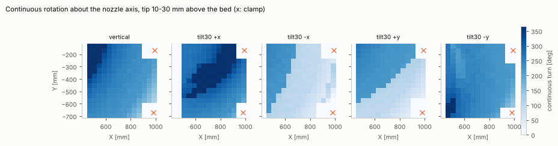

# Step 1 results: DP baseline for the redundancy angle

Simulation only. Generated by `python scripts/run_step1.py --out results` and `python scripts/write_results.py`. Every number depends on the estimated parameters in `config/planner.yaml` (tool and link capsules, clamp boxes, bed gap) and on the `estimated`/`unknown` values in `config/cell.yaml`.

Default nozzle tilt cap: 30 deg. Waypoints every 1.5 mm, 72 redundancy bins (5 deg), 32 IK slots per bin. Test surfaces are 240 x 240 mm patches centred on the bed (713, -410), planned on the layer 10 mm above the bed top; rasters 40 mm apart.

## Per surface (default tilt cap, bed centre)

| surface | points / length | planned | segments | max surface tilt | redundancy angle used | min joint-limit margin* | min abs(A5) | min clearance | runtime (states + DP) |
|---|---|---|---|---|---|---|---|---|---|
| dome | 1380 / 2069 mm | 100.0 % | 1 | 46 deg | 95..320 deg (span 225) | 26.2 deg | 53.2 deg | 15.0 mm | 14.4 s (10.6 + 3.8) |
| saddle | 1370 / 2054 mm | 100.0 % | 1 | 43 deg | -50..60 deg (span 110) | 19.3 deg | 28.0 deg | 12.3 mm | 11.8 s (8.2 + 3.6) |
| sine_wave | 1437 / 2155 mm | 100.0 % | 1 | 38 deg | 90..100 deg (span 10) | 29.3 deg | 73.5 deg | 15.0 mm | 17.3 s (12.7 + 4.6) |
| ramp_45 | 1374 / 2061 mm | 100.0 % | 1 | 44 deg | 90..90 deg (span 0) | 29.8 deg | 73.5 deg | 15.0 mm | 14.0 s (9.7 + 4.3) |
| perimeter | 1411 / 2116 mm | 55.7 % | 3 | 0 deg | -70..65 deg (span 135) | 27.2 deg | 47.4 deg | 0.1 mm | 14.0 s (12.3 + 1.8) |

*beyond the 2 deg margin from cell.yaml.

### Infeasible stretches (default tilt cap)

- **perimeter**: points 0-13 (s = 0-20 mm, around XY [457.0, -146.0]): collision (clamps_minus_x_pair)
- **perimeter**: points 302-427 (s = 453-641 mm, around XY [978.0, -162.0]): collision (clamp_plus_x_plus_y)
- **perimeter**: points 644-762 (s = 966-1144 mm, around XY [978.0, -671.0]): collision (clamp_plus_x_minus_y)
- **perimeter**: points 1045-1410 (s = 1568-2116 mm, around XY [448.0, -421.0]): collision (clamps_minus_x_pair)

## Reachable tilt range

A tilt cap counts as reachable when the whole path is planned in one continuous segment. The caps only bite up to each surface's own maximum normal tilt (dome 46, saddle 43, sine 38, ramp 44 deg); the 60 deg cap therefore means 'follow the normal everywhere'.

### Bed centre

| surface | reachable caps | runtime per run |
|---|---|---|
| dome | 0-60 deg (all tested) | 13.1-15.2 s |
| saddle | 0-60 deg (all tested) | 11.2-12.4 s |
| sine_wave | 0-60 deg (all tested) | 14.5-16.8 s |
| ramp_45 | 0-60 deg (all tested) | 12.0-13.4 s |

### Same surfaces moved to the bed quadrants

Planned share of the path per tilt cap; `x` marks a complete plan. The last column lists the reasons for the gaps. These patches reach to 10 mm from the bed edges, so they overlap the clamp boxes on purpose.

| patch centre | surface | cap 0 | cap 30 | cap 45 | cap 60 | reasons |
|---|---|---|---|---|---|---|
| -x-y (538,-584) | dome | 79 % | 73 % | 70 % | 70 % | collision (clamps_minus_x_pair) |
| -x-y (538,-584) | saddle | 93 % | 94 % | 94 % | 94 % | collision (clamps_minus_x_pair) |
| -x-y (538,-584) | sine_wave | 86 % | 84 % | 84 % | 84 % | collision (clamps_minus_x_pair) |
| -x-y (538,-584) | ramp_45 | 78 % | 78 % | 72 % | 72 % | collision (clamps_minus_x_pair) |
| -x+y (538,-236) | dome | 79 % | 73 % | 70 % | 70 % | collision (clamps_minus_x_pair) |
| -x+y (538,-236) | saddle | 93 % | 94 % | 94 % | 94 % | collision (clamps_minus_x_pair) |
| -x+y (538,-236) | sine_wave | 86 % | 84 % | 84 % | 84 % | collision (clamps_minus_x_pair) |
| -x+y (538,-236) | ramp_45 | 78 % | 78 % | 72 % | 72 % | collision (clamps_minus_x_pair) |
| +x-y (888,-584) | dome | 81 % | 79 % | 75 % | 75 % | collision (clamp_plus_x_minus_y); out of reach |
| +x-y (888,-584) | saddle | 84 % | 85 % | 85 % | 85 % | collision (clamp_plus_x_minus_y) |
| +x-y (888,-584) | sine_wave | 83 % | 80 % | 79 % | 79 % | collision (clamp_plus_x_minus_y) |
| +x-y (888,-584) | ramp_45 | 86 % | 86 % | 86 % | 86 % | collision (clamp_plus_x_minus_y) |
| +x+y (888,-236) | dome | 82 % | 80 % | 78 % | 78 % | collision (clamp_plus_x_plus_y) |
| +x+y (888,-236) | saddle | 87 % | 89 % | 89 % | 89 % | collision (clamp_plus_x_plus_y) |
| +x+y (888,-236) | sine_wave | 82 % | 80 % | 80 % | 80 % | collision (clamp_plus_x_plus_y) |
| +x+y (888,-236) | ramp_45 | 88 % | 88 % | 88 % | 88 % | collision (clamp_plus_x_plus_y) |

## Findings

- **Bed centre: no limit from tilt.** All four surfaces plan as one continuous segment for every tilt cap
  from 0 to 60 deg (that is, up to the full surface normal, 38-46 deg). At the default cap the joint-limit margin stays >= 19 deg
  and |A5| >= 28 deg. Runtime is 10-15 s per path of ~1400 points on one CPU core
  (about 70 % building states (IK + collision), 30 % DP).
- **Toward the edges, the clamps decide, not the tilt.** Every gap in the quadrant runs is a clamp
  collision, except one short out-of-reach stretch near the +X/-Y corner (dome). Raising the cap
  from 0 to 45 deg costs up to 9 % more of the path (dome at -X), because a tilted tool body sweeps
  further sideways into the clamp boxes.
- **The -X clamp pair blocks a band along the whole -X edge** because its Y positions are unknown, so it is
  modelled as a strip over the full edge. The -X/-Y and -X/+Y results are identical for this reason.
  Measuring the Y of those two clamps would free most of that band.
- **The perimeter path (bed outline inset 40 mm) is 56 % plannable**, cut into 3 pieces at the
  three modelled clamp locations.
- **The DP sometimes turns the nozzle a lot.** On the dome it rotates by 215 deg about the nozzle axis
  within 75 mm of path (s = 1230-1305 mm, at most 5 deg per waypoint, A4 step <= 5.2 deg). This is
  inside every hard limit and cheap under the joint-space smoothness cost, but it would wind the hose.
  A cost on the redundancy angle's rate, or a cap on it, is the obvious knob (`max_dbin`, weights in
  `config/planner.yaml`).
- **On flat or gently curved paths the chosen angle is nearly constant** (sine 90-100 deg, ramp 90 deg:
  tool +Z towards BASE -Y), away from the 0 deg of the planar programs (A0 B90 C0). With the default weights
  any angle well inside the limits costs almost the same, so this choice is arbitrary to within the window.

## Continuous turn about the nozzle axis

Longest rotation about the nozzle axis that can be swept continuously at a fixed point (5 deg bins, at most 10 deg per joint between bins, limits with margin, collisions), on a 40 mm grid over the bed. Bed centre, vertical nozzle: 240 deg.

`tilt30 +x` means the nozzle (tool +X) is tilted 30 deg from straight down towards BASE +X, i.e. the tip points away from the robot. Values over 360 deg use the second A6 turn.

At the bed centre the window is set by A5 = +-120 deg (+-118 with the margin): with A5 widened to +-180 and collisions off it becomes a full 360 deg. Collisions do not shrink it there. This matches the earlier 235-285 deg.

| nozzle | median | max | grid points with no feasible angle |
|---|---|---|---|
| vertical | 240 deg | 365 deg | 15 % |
| tilt30 +x | 280 deg | 365 deg | 19 % |
| tilt30 -x | 100 deg | 245 deg | 16 % |
| tilt30 +y | 115 deg | 265 deg | 15 % |
| tilt30 -y | 235 deg | 365 deg | 13 % |

## KRL export: moves between segments (issue #2)

Before, a segment break in the export was a PTP straight from the last printed point to the next start, at print height, unchecked, at the controller's default axis speed. Now each break is a LIN retract along the nozzle axis to at least 30 mm above the bed top (and at least 15 mm above the highest Z printed so far), a PTP that is sampled in joint space and checked against the bed, the clamps and the floor (tip included), lifted to 80, 120, 180 mm if it collides, and a LIN approach; if no candidate is clear, the export fails. `$VEL_AXIS` = 5 % and `$ACC_AXIS` = 10 % are set on all axes; before every transit PTP `$VEL_AXIS` is lowered to floor(5 x min(1, 0.8 x 100 / peak)) % (at least 1 %) so the model peak is <= 80 mm/s; a transit still above that at 1 % fails the export unless `allow_fast_transit` is set. A transit that turns A4 or A6 by more than 180 deg is flagged (hose / cable wrap not modelled).

TCP speeds are a **model estimate**: every axis at most `$VEL_AXIS` % of its URDF velocity (unverified) and `$ACC_AXIS` % of an assumed acceleration, the leading axis sets a trapezoid rate along the joint-space line (a move too short to reach cruise is capped by its distance), peak TCP speed = max |dx/ds| x that rate. 'Before' assumes 100 % axis speed and acceleration. Clearance is the margin to the inflated collision boxes (bed gap 5 mm, clamps +20 mm); negative means inside. The bed top is at Z 0.95.

| toolpath | transit | before: min clearance (obstacles hit) | before: lowest TCP Z | before: peak TCP (model) | after: PTP height | after: min clearance per move | after: min distance to bed | after: $VEL_AXIS | after: peak TCP (model) | rejected candidates | flags |
|---|---|---|---|---|---|---|---|---|---|---|---|
| perimeter | 0->1 | -17.9 mm (clamp_plus_x_plus_y, bed) | Z 2.2 | 949 mm/s | Z 81.0 | retract 1.4, lift 15.4, transit 17.1, lower 15.3, approach 1.3 mm | 27.0 mm | 4 % | 76 mm/s | z 31: PTP collides with clamp_plus_x_plus_y (clearance -10.0 mm at 6 % of the move) | none |
| perimeter | 1->2 | -15.7 mm (clamp_plus_x_minus_y, bed) | Z 2.2 | 458 mm/s | Z 81.0 | retract 0.2, lift 14.6, transit 19.0, lower 15.2, approach 1.1 mm | 27.0 mm | 5 % | 64 mm/s | z 31: PTP collides with clamp_plus_x_minus_y (clearance -10.0 mm at 15 % of the move) | none |

Clearance per move: retract / approach LINs with the tip exempt from the bed (they start on the print), PTP and lift / lower LINs with the tip included.

Flag thresholds: peak TCP speed > 80 mm/s (only with `allow_fast_transit`), |dA4| or |dA6| > 180 deg, any collision, any primitive (tip included) closer than 15 mm to the bed at transit height. Retract and approach LINs run at the print `$VEL.CP` with the orientation held. Every export also approaches its first point and leaves its last point the same way.

First PTP (from the pose the robot is in when a program starts; `kukasim/first_ptp.py`): its TCP speed is at most sum_i ($VEL_AXIS % x URDF axis max speed) x r_i from any start, with the axis-to-tool-tip radii r_i = 1428.6, 1403.6, 843.5, 330.3, 327, 225.6 mm (bounded from the URDF and TOOL 3). At $VEL_AXIS 1 % this bound is 236.9 mm/s, above 80 mm/s, so no start-independent bound exists (case `declared start`): the programs require the robot to be at the declared start pose {A1 0, A2 -90, A3 90, A4 0, A5 0, A6 0} (+-1 deg per axis, `transit.start_axis`, a default to be replaced by the cell's real start pose) and lower $VEL_AXIS for the first PTP with the transit speed model. The path of the first PTP is not collision-checked.

| surface | case | first PTP $VEL_AXIS | peak TCP (model, worst over the tolerance box) |
|---|---|---|---|
| dome | declared start | 1 % | 41.3 mm/s |
| saddle | declared start | 1 % | 44.7 mm/s |
| sine_wave | declared start | 1 % | 50.7 mm/s |
| ramp_45 | declared start | 1 % | 51.3 mm/s |
| perimeter | declared start | 1 % | 43.8 mm/s |

## Files per toolpath (`results/<surface>/`)

`trajectory.csv` (joints, TCP, ABC, margins), `joints.png`, `margins.png`, `feasibility.png`, `animation.gif`, `<surface>.src` (KRL, NOT RUN header), `export_report.json` (transits and their flags).

